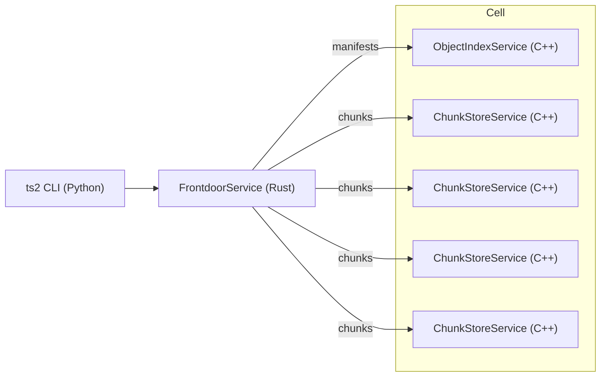

# TS2

TS2 (Toy Storage Service) is an S3-like object store that you can run on a laptop. You store a file under a name, and you get the same bytes back later, over a plain JSON REST API. It is a learning build by Pratik Sethi, made to understand how an object store works inside.

Under the API, big files are cut into 4 MiB pieces that are stored on separate nodes, and a small database remembers which pieces make up which file. It also has limits, error contracts, metrics and dashboards, because that is where storage lessons come from. Failure drills are planned, not built.

**Status:** Built today: FrontdoorService, ObjectIndexService and four ChunkStoreService nodes, run in one process (`make run`) or in docker compose (`make up`). There is one cell (one ObjectIndexService plus its ChunkStoreService nodes), one copy of each chunk (a 4 MiB piece of an object, defined below) and one index, so it is not durable. Replication, more cells, auth and the Go service are planned. See [what is built](docs/plan.md).

## Three words you need

**Bucket and key.** A bucket is a named container, like `photos`. A key is an object's name inside a bucket, like `cats/cat.jpg`. A key looks like a path, but there are no directories. The slash is just a character, and listing "everything under `cats/`" is a string prefix scan over the keys.

**Chunk.** Objects bigger than 64 KiB are cut into pieces of 4 MiB, called chunks. Each chunk gets a random id and is stored on one ChunkStoreService node. A 9 MiB photo becomes three chunks: 4 MiB, 4 MiB and 1 MiB.

**Manifest.** The manifest is the small record kept for each object. It holds the size, the ETag (a fingerprint of the object's bytes: their SHA-256 hash in hex), the content type, the version, and the ordered list of chunk ids with the node that holds each one. Objects under 64 KiB skip chunking and sit inside the manifest itself (`inline_data`). To read an object, you look up its manifest, then fetch its chunks in order. Here is the manifest for `photos/cats/cat.jpg`, a 9 MiB file (hashes shortened):

```json
{
  "bucket": "photos",
  "key": "cats/cat.jpg",
  "version": 1,
  "size": 9437184,
  "etag": "9f2c…e1",
  "content_type": "image/jpeg",
  "created_at": "2026-11-22T09:30:00Z",
  "metadata": {},
  "chunk_bytes": 4194304,
  "chunks": [
    { "chunk_id": "a1b2…01", "node_id": "node-1", "length": 4194304, "checksum": "77d0…3a" },
    { "chunk_id": "c3d4…02", "node_id": "node-3", "length": 4194304, "checksum": "0be5…c9" },
    { "chunk_id": "e5f6…03", "node_id": "node-2", "length": 1048576, "checksum": "d41f…58" }
  ]
}
```

## How it fits together



- **FrontdoorService** (Rust) is the only thing clients talk to. It checks limits, cuts an upload into chunks, writes them to ChunkStoreService nodes, and then writes the manifest to ObjectIndexService. On a read it does the reverse. Its code is in `frontdoor/`, and the chunking, hashing and placement logic is the `ts2-core` library.
- **ObjectIndexService** (C++) stores manifests by (bucket, key) and answers listings. It never sees object bytes.
- **ChunkStoreService** (C++) stores chunks. One process owns one data directory, which means one disk.
- A **cell** is one ObjectIndexService plus its ChunkStoreService nodes. There is one cell today. More cells (planned, v0.4) would mean more capacity, and a fault would stay inside one cell. Buckets are stored by ObjectIndexService, as there is no separate bucket service yet.
- The **`ts2` CLI** (Python) and the end-to-end tests call the REST API.

`make run` starts FrontdoorService alone. It then uses a SQLite file (a small database in one file) as the index and a local directory as the chunk store, inside its own process, through the `ts2-core` library. `make up` starts it with the C++ services instead, and FrontdoorService talks to them over gRPC (a way for services to call each other over the network, using Protobuf messages). Both modes implement the same two Rust traits.

## What it is not

- Not S3 compatible. The API is JSON REST, not S3 XML with SigV4. An adapter may come later.
- Not durable. Each chunk has one copy. Replication is planned for v0.4 and erasure coding for v0.5. Until then the single index is also the point of loss, because replication would protect chunks and not manifests.
- Not multi-region, not hardened for multiple tenants, and not benchmarked against production systems.
- Not a place for data you cannot lose. Use S3 or MinIO for real work.

## Quickstart

```sh
make run          # builds and starts FrontdoorService on 127.0.0.1:9000, data in ./data
```

Tools to install first are listed in [docs/setup.md](docs/setup.md). Then follow the curl walkthrough in [docs/demo.md](docs/demo.md). Interactive API docs are at <http://127.0.0.1:9000/docs>. `make test` runs the tests, `make up` runs the same thing in docker compose on port 9001, and `make docs` serves these docs locally. Every port the system uses is listed in [docs/ports.md](docs/ports.md).

## FAQ

**Who is it for?** The builder first. The tenant types in the [PRD](docs/prd.md) (assets, media, analytics, ML datasets, backups) shape realistic requirements.

**What runs today?** FrontdoorService with either in-process backends (`make run`) or the C++ ObjectIndexService and four ChunkStoreService nodes (`make up`). PUT, GET, DELETE and list, a CLI, a docker compose setup and an optional observability stack.

**Why so many languages?** (Each design decision is written down in an ADR, an architecture decision record: a short note on what was decided and why.) Each layer gets the language that fits: Rust for FrontdoorService, C++ for the data plane, Python for the CLI and tests. Go is planned for a BucketRegistryService that is not built. See [ADR 0002](docs/adr/0002-rust-frontdoor-go-bucket-registry-cpp-data-plane.md).

## Repo layout

```
frontdoor/         Rust, FrontdoorService
ts2-core/          Rust library: chunking, hashing, placement, ObjectIndex and ChunkStore traits
ts2-proto/         Rust crate that compiles the proto files
object-index/      C++, ObjectIndexService
chunk-store/       C++, ChunkStoreService
cli/               Python, the ts2 command
proto/             gRPC definitions
config/            frontdoor config files
deploy/compose/    docker compose and the observability stack
tests/e2e/         Python end-to-end tests
docs/
```

Planned, not created yet: `bucket-registry/` (Go, v0.4), `ui/` (TypeScript) and `deploy/cdk/` (AWS CDK).

## Docs

- [CLI reference](docs/cli/index.md): every `ts2` command, with a try-it session.
- [docs/index.md](docs/index.md): the docs site home. Run `make docs` and open http://127.0.0.1:8000/ to browse everything below.
- [PRD](docs/prd.md): requirements, limits, milestones.
- [System overview](docs/design/000-system-overview.md): the full design, request paths and decisions.
- [ADRs](docs/adr/0007-multi-word-service-names.md): why things are the way they are.
- [Plan](docs/plan.md) and [backlog](docs/backlog.md): what is built and what comes next.
- [Demo](docs/demo.md): curl walkthrough.
- [API reference](docs/api/index.md): the OpenAPI spec, rendered in the docs site.

## License

To be decided.
