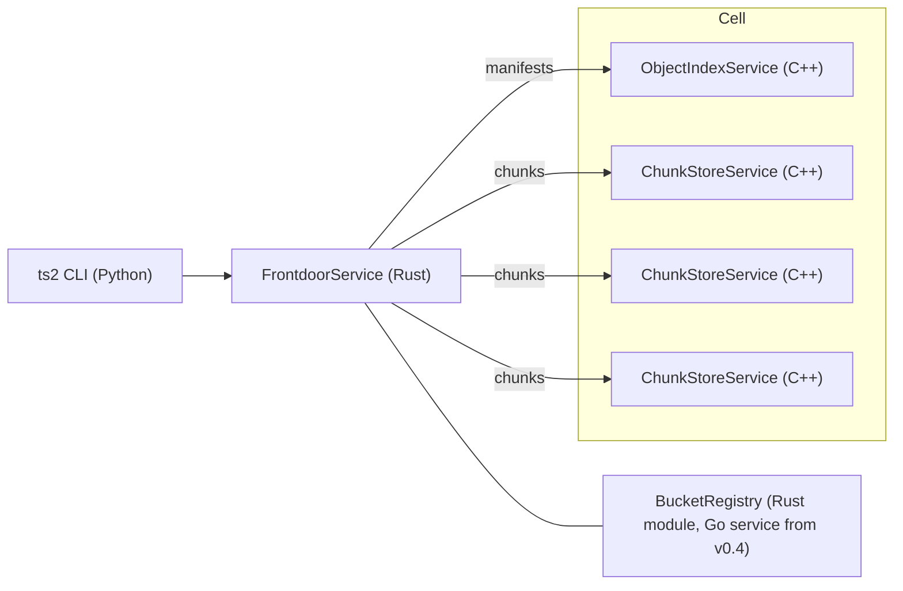

# TS2

TS2 (Toy Storage Service) is an S3-like object store that you can run on a laptop. You store a file under a name, and you get the same bytes back later, over a plain JSON REST API. It is a learning build by Pratik Sethi, made to understand how an object store works inside.

Under the API, big files are cut into 4 MiB pieces that are stored on separate nodes, and a small database remembers which pieces make up which file. It also has limits, error contracts, metrics, dashboards and failure drills, because that is where storage lessons come from.

**Status:** v0.1 runs locally as a single binary. It is not durable yet.

## Three words you need

**Bucket and key.** A bucket is a named container, like `photos`. A key is an object's name inside a bucket, like `cats/cat.jpg`. A key looks like a path, but there are no directories. The slash is just a character, and listing "everything under `cats/`" is a string prefix scan over the keys.

**Chunk.** Objects bigger than 64 KiB are cut into pieces of 4 MiB, called chunks. Each chunk gets a random id and is stored on one ChunkStoreService node. A 9 MiB photo becomes three chunks: 4 MiB, 4 MiB and 1 MiB.

**Manifest.** The manifest is the small record kept for each object. It holds the size, ETag, content type, version, and the ordered list of chunk ids with the node that holds each one. Objects under 64 KiB skip chunking and sit inside the manifest itself (`inline_data`). To read an object, you look up its manifest, then fetch its chunks in order. Here is the manifest for `photos/cats/cat.jpg`, a 9 MiB file (hashes shortened):

```json
{
  "bucket": "photos",
  "key": "cats/cat.jpg",
  "version": 1,
  "size": 9437184,
  "etag": "9f2c…e1",
  "content_type": "image/jpeg",
  "created_at": "2026-11-22T09:30:00Z",
  "metadata": {},
  "chunk_bytes": 4194304,
  "chunks": [
    { "chunk_id": "a1b2…01", "node_id": "node-1", "length": 4194304, "checksum": "77d0…3a" },
    { "chunk_id": "c3d4…02", "node_id": "node-3", "length": 4194304, "checksum": "0be5…c9" },
    { "chunk_id": "e5f6…03", "node_id": "node-2", "length": 1048576, "checksum": "d41f…58" }
  ]
}
```

## How it fits together



- **FrontdoorService** (Rust) is the only thing clients talk to. It checks limits, cuts an upload into chunks, writes them to ChunkStoreService nodes, and then writes the manifest to ObjectIndexService. On a read it does the reverse. Its code is in `frontdoor/`, and the chunking, hashing and placement logic is the `ts2-core` library.
- **BucketRegistry** (Rust module now, BucketRegistryService in Go from v0.4) knows which buckets exist, who owns them, their quotas, and which cell each bucket lives in.
- **ObjectIndexService** (C++) stores manifests by (bucket, key) and answers listings. It never sees object bytes.
- **ChunkStoreService** (C++) stores chunks. One process owns one data directory, which means one disk.
- A **cell** is one ObjectIndexService plus its ChunkStoreService nodes. More cells means more capacity, and a fault stays inside one cell.
- The **`ts2` CLI** (Python) and the end-to-end tests call the REST API.

Until the C++ services exist (see the [plan](docs/plan.md)), `ts2-core` runs a SQLite file as the index and a local directory as the chunk store, inside the FrontdoorService process. The code behind them is the same traits the real services will implement.

## What it is not

- Not S3 compatible. The API is JSON REST, not S3 XML with SigV4. An adapter may come later.
- Not durable in v0. Replication arrives in v0.4 and erasure coding in v0.5. Until v0.4 the single index is also the point of loss, because replication protects chunks and not manifests.
- Not multi-region, not hardened for multiple tenants, and not benchmarked against production systems.
- Not a place for data you cannot lose. Use S3 or MinIO for real work.

## Quickstart

```sh
make run          # builds and starts FrontdoorService on 127.0.0.1:9000, data in ./data
```

Tools to install first are listed in [docs/setup.md](docs/setup.md). Then follow the curl walkthrough in [docs/demo.md](docs/demo.md). Interactive API docs are at <http://127.0.0.1:9000/docs>. `make test` runs the tests, `make up` runs the same thing in docker compose on port 9001, and `make docs` serves these docs locally. Every port the system uses is listed in [docs/ports.md](docs/ports.md).

## FAQ

**Who is it for?** The builder first. The tenant types in the [PRD](docs/prd.md) (assets, media, analytics, ML datasets, backups) shape realistic requirements.

**What does v0.1 do?** One FrontdoorService with an in-process SQLite index and a local-disk chunk store. PUT, GET, DELETE and list, a CLI and a docker compose setup.

**Why so many languages?** Each layer gets the language that fits: Rust for FrontdoorService, Go for BucketRegistryService, C++ for the data plane, Python for the CLI and tests. See [ADR 0002](docs/adr/0002-rust-frontdoor-go-bucket-registry-cpp-data-plane.md).

## Repo layout

```
frontdoor/         Rust, FrontdoorService
ts2-core/          Rust library: chunking, hashing, placement, ObjectIndex and ChunkStore traits
bucket-registry/   Go, BucketRegistryService, from v0.4
object-index/      C++, ObjectIndexService
chunk-store/       C++, ChunkStoreService
cli/               Python, the ts2 command
ui/                TypeScript, later
proto/             gRPC definitions
deploy/            compose, CDK
tests/e2e/         Python
docs/
```

Only `frontdoor/`, `ts2-core/`, `deploy/compose/` and `docs/` exist today.

## Docs

- [docs/index.md](docs/index.md): the docs site home. Run `make docs` and open http://127.0.0.1:8000/ to browse everything below.
- [PRD](docs/prd.md): requirements, limits, milestones.
- [System overview](docs/design/000-system-overview.md): the full design, request paths and decisions.
- [ADRs](docs/adr/0007-multi-word-service-names.md): why things are the way they are.
- [Plan](docs/plan.md) and [backlog](docs/backlog.md): what is built and what comes next.
- [Demo](docs/demo.md): curl walkthrough.

## License

To be decided.
