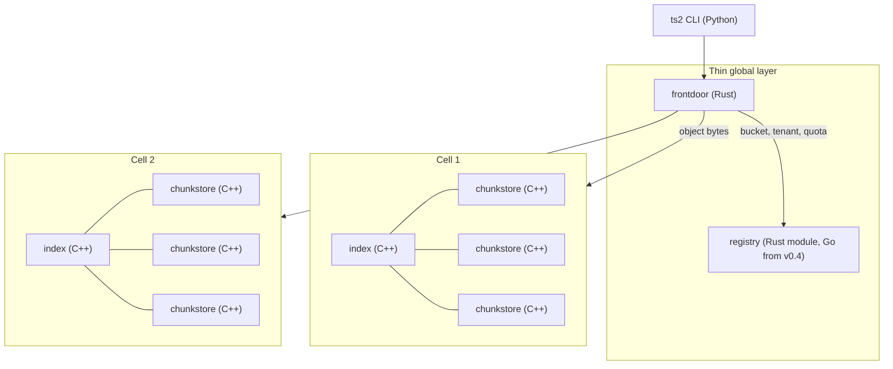
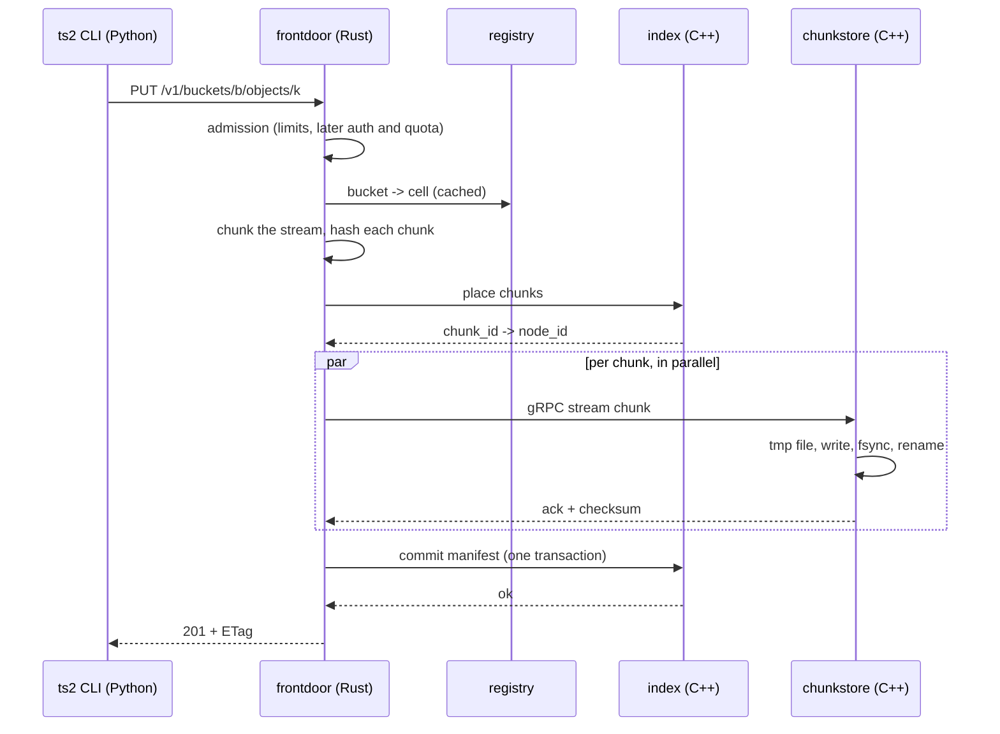
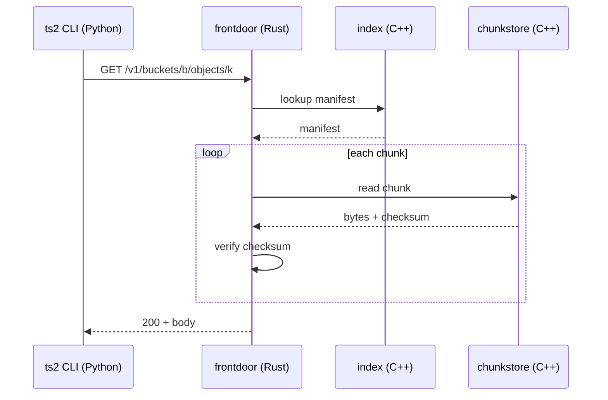
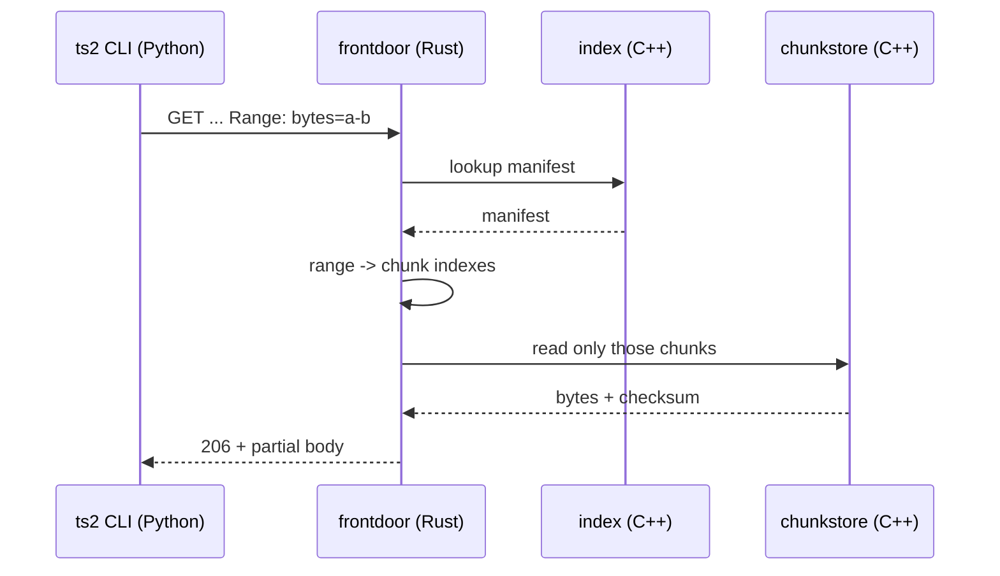
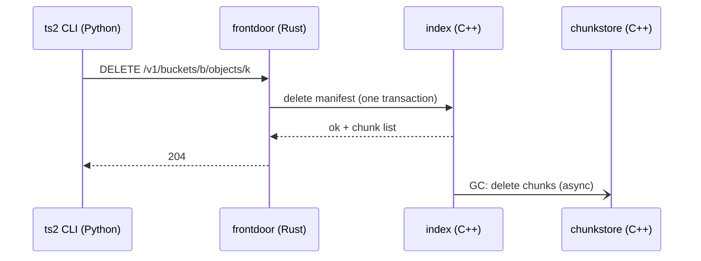
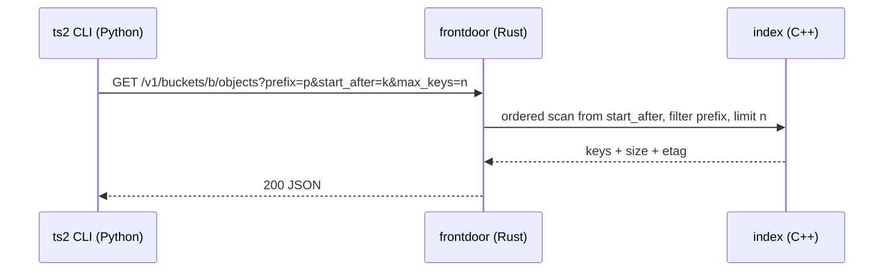

# 000: System overview

Status: draft. Read time: about 15 minutes.

Glossary, mapped to the S3 front end / index / storage shape: **frontdoor** is the front end, **index** is the index, **chunkstore** is storage. **registry** holds buckets, tenants and quotas. A **cell** is a self-contained copy of index plus chunkstores.

## 1. Context

TS2 (Toy Storage Service) is an S3-like object store built to learn storage internals. Clients talk JSON REST to the frontdoor. Objects are split into chunks and stored on chunkstore nodes. The index maps each key to a manifest that lists its chunks. Requirements are in the [PRD](../prd.md).

Reference systems, for orientation only:

- MinIO stores each object as an `xl.meta` file plus part files on a regular filesystem (XFS is the usual choice).
- Ceph BlueStore writes to raw block devices, keeps metadata in RocksDB, and places data with CRUSH, a deterministic function from object to devices.
- S3 runs its own HDD fleet. Its storage node software, ShardStore (written in Rust, SOSP 2021 paper), writes shards into log-structured extents with an LSM-tree index. S3's architecture as presented at re:Invent 2023 is front end, then index, then storage.

TS2 borrows the shape (front end, index, storage), the deterministic placement idea, and the extent design for v0.6.

## 2. Planes and the thin layer

Three layers, from the client inward:

1. **Frontdoor** (`ts2-frontdoor`). The web service in front, and the only thing clients reach. It does admission: validates the request, checks size and key limits, later checks auth and quota, and sheds load with 429 or 503 plus `Retry-After`. It never queues requests. It does not write to a database per request; it emits an access log line and metrics instead. After admission it sends bucket and tenant operations to the registry and object bytes down the data path. Object bytes flow through frontdoor, see [ADR 0006](../adr/0006-object-bytes-through-frontdoor.md).
2. **Registry.** Tenants, buckets, quotas, the bucket-to-cell map and cell health. Until v0.4 it is an in-process module of frontdoor behind a `Registry` trait. In v0.4 it is extracted into its own Go service (`registry/`).
3. **Data plane.** Deployed as cells. Each cell has an index (key to manifest) and chunkstore nodes (chunks).

**What a chunkstore node is.** One process that owns one data directory, which in production means one disk. A production host would have many HDD or NVMe drives and run one chunkstore process per drive, so the failure domain is the rack. In the compose demo it is one container per node with a named volume. On AWS it is one EC2 instance with EBS or instance-store NVMe.



### Registry propagation after the v0.4 extraction

- Frontdoor calls the registry synchronously over gRPC (tonic client, Go gRPC server).
- Registry reads are cached in frontdoor. Changes reach frontdoor by polling every few seconds. Push may come later.
- Admin writes (create bucket, set quota) are proxied synchronously and are idempotent. Frontdoor never acknowledges a write the registry has not committed.
- `request_id` and the W3C `traceparent` header travel as gRPC metadata, so one request is traceable across services.
- If the registry is down, frontdoor keeps serving object traffic from its cache. With a cold cache it returns 503 plus `Retry-After`.

## 3. Cells

A cell is a self-sufficient copy of the data plane: one index plus N chunkstore nodes, serving a fixed subset of buckets. Cells never talk to each other.

The thin global layer above the cells is the frontdoor router plus the registry's bucket-to-cell map. It is kept small because its blast radius is everyone. Per-cell control functions (node membership, the placement map, health, rebalancing) live inside the cell, so a bug there can hurt only that cell.

Tenant and quota data sits in the thin layer for v0. The alternative is to keep per-cell quota counters inside each cell and sum them, which removes a global dependency from the write path but makes tenant-wide quotas harder. Decision: global for v0, see section 12.

What cells give us:

- **Blast radius.** A bad deploy or a corrupted index affects one cell.
- **Fixed, tested size.** A cell is always the same shape, so we test that shape.
- **Scale by adding cells.** New buckets go to new cells.
- **Cell-by-cell rollout.** Deploy to one cell, watch, continue.
- **Tenant moves.** Copy manifests and chunks to another cell, flip the bucket in the registry, garbage-collect the source.

## 4. Components and languages

| Component | Service / directory | Language | Notes |
|---|---|---|---|
| Frontdoor | `ts2-frontdoor`, `frontdoor/` | Rust | axum, tonic, tower, utoipa |
| `ts2-core` | `ts2-core/` | Rust (library crate) | chunking, hashing and placement logic that frontdoor calls, so a direct-to-cell client can reuse it later |
| Registry | in `frontdoor/` until v0.4, then `registry/` | Rust, then Go | `Registry` trait first; Go service with a gRPC server from v0.4 |
| CLI | `cli/` | Python | binary named `ts2`; typer, httpx, client generated from the OpenAPI file; installed with `uv tool install` |
| Index | `ts2-index`, `index/` | C++ | key to manifest; SQLite first, RocksDB later |
| Chunkstore | `ts2-chunkstore`, `chunkstore/` | C++ | CMake, vcpkg, Catch2 |
| Web UI | `ui/` | TypeScript | later, React possible |
| End-to-end tests | `tests/e2e/` | Python | uv, pytest, httpx; shares uv tooling with the CLI |

Contracts: the external API is OpenAPI 3.1, generated from code. Frontdoor uses utoipa to build the spec from annotated axum handlers, serves it at `/openapi.json` and serves a Scalar UI at `/docs`. A test writes the generated spec to `docs/api/openapi.yaml`, so API changes show up in review diffs and the file imports into Bruno or curl workflows. The Python CLI client is generated from that file. The internal API is Protobuf over gRPC in `proto/ts2/v1`. Rationale in [ADR 0001](../adr/0001-json-rest-over-s3-wire-compat.md) and [ADR 0002](../adr/0002-rust-frontdoor-go-registry-cpp-data-plane.md).

External endpoints (all under `/v1`):

- Buckets: create, list, get, delete.
- Objects: PUT, GET (with `Range`), HEAD, DELETE.
- List objects: GET with `prefix`, `start_after`, `max_keys`. The IETF HTTP QUERY method is parked until it is an RFC.
- `GET /v1/quotas` (v0.3).

## 5. Request paths

Terms: a **chunk** is a fixed-size slice of an object. A **manifest** is the record for one key: its metadata plus the list of chunks. A **cell** is defined above.

### PUT

Invariant: chunks are durable before the manifest is committed. A crash in between leaves orphan chunks for garbage collection (GC). It never leaves a manifest that points at missing chunks.



Placement. v0.2 rule: `node = hash(chunk_id) mod N`, replication factor R=1. v0.4: R=3 across failure domains. Like Ceph's CRUSH the rule is deterministic, but the manifest still records the placement, so changing the rule later does not strand old objects.

### GET



### Range GET

Frontdoor maps the byte range to chunk indexes using `chunk_bytes` from the manifest, reads only those chunks (and only the needed byte range inside the first and last), and returns 206. Inline objects are served from the manifest.



### DELETE

Delete removes the manifest in one transaction and returns 204. The chunks become orphans, and the index's GC removes them later (section 12). Deleting the manifest first keeps the invariant: no manifest ever points at a missing chunk.



### List



List touches only the index. Keys are ordered bytewise.

## 6. Data model

Manifest, one per object key:

| Field | Meaning |
|---|---|
| `bucket`, `key` | identity |
| `version` | manifest version number |
| `size` | object size in bytes |
| `etag` | returned on PUT and GET |
| `content_type` | as supplied by the client |
| `created_at` | commit time |
| `metadata` | user metadata, string map |
| `inline_data` | object bytes, present only when size is below `inline_threshold_bytes` |
| `chunk_bytes` | chunk size used for this object |
| `chunks` | list of `(chunk_id, node_id, length, checksum)`, present only when not inline |

An object has either `inline_data` or `chunks`, never both.

Chunk ids are random 128-bit values. The content hash is stored beside the id as the checksum. Content-addressed ids (id = hash of bytes) would give deduplication but require reference counting before GC can delete a chunk. That is rejected for v0, see [ADR 0003](../adr/0003-random-chunk-ids-not-content-addressed.md).

## 7. On-disk layout

Both layouts sit behind one C++ `ChunkStore` interface: `put`, `get(range)`, `del`, `scrub`.

**v0.1: one file per chunk.** MinIO style, easy to debug with `ls`.

```
node-root/
  node.json
  tmp/                 in-flight writes
  data/chunks/ab/cd/<chunk_id>
```

A write goes to `tmp/`, is fsynced, then renamed into place. The two-level directory fan-out comes from the first bytes of the id.

**v0.6: extents.** Append-only extent files of 1 GiB. An index maps `chunk_id -> (extent, offset, len, crc)` and lives in RocksDB. Compaction reclaims holes left by deletes, and a scrub pass re-reads data and checks crcs. This is the S3 ShardStore and Haystack style. The v0.6 milestone benchmarks it against the file-per-chunk layout.

**Platform differences** live in a `FileSystem` abstraction: `fsync` on Linux versus `fcntl(F_FULLFSYNC)` on macOS, `O_DIRECT` on Linux versus `F_NOCACHE` on macOS, and an optional Linux-only io_uring backend.

## 8. Configuration and limits

Each service loads a config file and reloads it on change (SIGHUP or file watch). Limits and feature flags therefore change without a redeploy. A `flags` block in the same file holds feature flags. A config service and OpenFeature with flagd are deferred, see [ADR 0005](../adr/0005-file-reload-config-before-config-service.md).

```yaml
limits:
  max_object_bytes: 268435456      # 256 MiB, 413 when exceeded
  max_key_bytes: 1024
  inline_threshold_bytes: 65536    # 64 KiB
  chunk_bytes: 4194304             # 4 MiB
flags: {}
```

Safe to change later: anything recorded per object in the manifest (`chunk_bytes`, `inline_threshold_bytes`) and `max_object_bytes` upward. Not safe: `max_key_bytes` downward, since existing keys may be longer.

Quotas are per-tenant defaults with overrides (buckets per tenant, bytes per bucket, requests/s). They are stored in the registry, enforced at admission from a cached snapshot, and exposed at `GET /v1/quotas`. Milestone v0.3.

Errors use RFC 9457 Problem Details with a `request_id` extension. Responses carry `Server: ts2-frontdoor/<version>` and `x-ts2-request-id`.

## 9. Observability

OpenTelemetry (OTel) SDK in every service, sending to an OTel Collector. The Collector forwards metrics to VictoriaMetrics (OTLP ingest) and logs to VictoriaLogs. Grafana reads both, with dashboards provisioned from the repo. Traces come later, with Tempo or VictoriaTraces. This mirrors the public description of Roblox's pipeline (OTel SDK and Collector, a Kafka buffer, Logstash and Elastic for logs, VictoriaMetrics, Grafana), minus Kafka and with VictoriaLogs instead of Elastic to stay light.

| Scope | Metrics | Alarms |
|---|---|---|
| Frontdoor | RED (rate, errors, duration) per API, bytes in and out, in-flight requests | 5xx above 0.1% for 5 min; p99 PUT above 500 ms; in-flight near cap |
| Index | op latency, RocksDB stalls, WAL size | stall above 0; p99 lookup above 20 ms |
| Chunkstore | disk used %, chunk read and write latency, fsync latency, IO errors, scrub failures, under-replicated chunks, repair backlog | disk above 85%; any IO error; under-replicated above 0 for 10 min; scrub failure above 0 |
| Cell | SLO burn rate, fast (1 h) and slow (6 h) | burn-rate alerts on both windows |

RocksDB metrics apply from v0.3. Under-replicated and repair metrics apply from v0.4.

## 10. Deployment

Local first. `make` is the only entry point: `build`, `test`, `up`, `down`, `chaos`, each dispatching to the components.

- **Local:** docker compose with frontdoor (registry in-process until v0.4), 2 cells each with an index and 3 chunkstore nodes. Named volume per chunkstore node. `--profile obs` adds the observability stack.
- **Later, k3d and Helm:** chunkstore nodes as a StatefulSet.
- **Later, AWS via CDK on Graviton:** first one EC2 instance running compose, then 3 nodes on k3s, one per AZ.

**Load balancer.** Every real deployment is DNS, then a load balancer, then the frontdoor fleet. Compose has none (Traefik is optional for local TLS). k3d uses an Ingress. On AWS start with an ALB (application load balancer): it terminates TLS, runs HTTP health checks and routes by path, for example to the UI. Move to an NLB (network load balancer) when raw throughput matters, since it works at layer 4 and does no HTTP parsing.

Build target is linux/arm64 only, cross-built with buildx from the Mac. Artifacts come from GitHub Actions and GHCR, or ECR, through a script that switches on `ARTIFACT_SOURCE=local|github|aws`.

Repo layout (monorepo, one component per commit so each is testable alone): `Makefile`, `docs/`, `proto/`, `frontdoor/`, `ts2-core/`, `registry/` (v0.4), `cli/`, `index/`, `chunkstore/`, `ui/`, `deploy/compose/`, `deploy/cdk/`, `tests/e2e/`.

## 11. Per-component design docs

To be written:

- 001, Frontdoor: admission, load shedding, routing, streaming and chunking.
- 002, Registry: tenants, buckets, quotas, bucket-to-cell map, cell health, jobs API.
- 003, Index: manifest schema, transactions, list, orphan GC, SQLite then RocksDB.
- 004, Chunkstore: ChunkStore, FileSystem abstraction, extents, scrub.
- 005, Placement and replication: the placement rule, R=3, failure domains, erasure coding, repair.
- 006, Observability: metric names, dashboards, alarms, SLO math.
- 007, Deployment: compose, k3d, CDK, artifact sources.

## 12. Decisions and open questions

### Decisions

- **Orphan chunk GC.** Owned by the index. It periodically asks each chunkstore for its chunk ids and deletes ids that no manifest references.
- **Overwrite.** A second PUT replaces the manifest and increments `version`. The old chunks become orphans. No user-visible object versioning in v0.
- **ETag.** Computed by frontdoor from the stream.
- **Quota counters.** Global, in the registry, for v0.
- **Registry changes reach frontdoor** by polling every few seconds. Push may come later.
- **Admin writes** (create bucket, set quota) are synchronous and return 201 or 204. Each is one database row.
- **Long-running workflows** (bulk bucket delete, tenant moves, rebalance, repair, tiering, key and cert rotation) use a jobs API: the request returns 202 with `Location: /v1/jobs/{id}`. A job row in the registry database is the queue, and each step is idempotent and resumable. This first appears in v0.4. Temporal is a possible later engine for these jobs and is explicitly deferred.
- **Idempotency.** Every API is idempotent or carries an idempotency key. Frontdoor never acknowledges a write it has not seen committed downstream.

### Open questions

- How frontdoor learns about a bucket move between cells before its next poll (stale routing window, and what a chunkstore or index does with a misrouted request).
- Whether the Python e2e suite runs against compose only or also against k3d.
