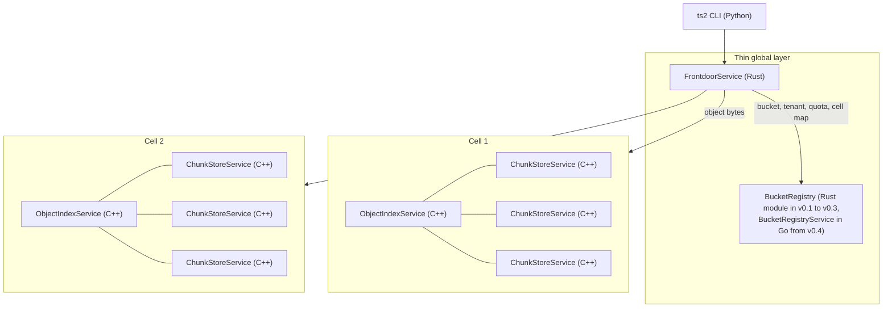
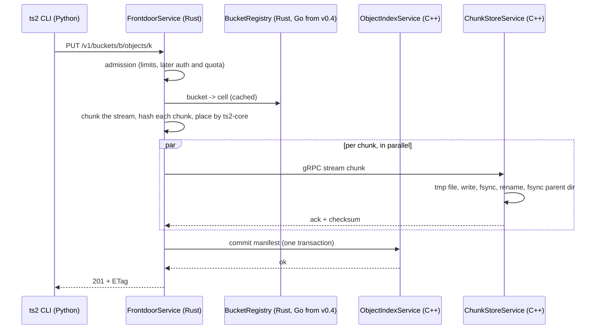
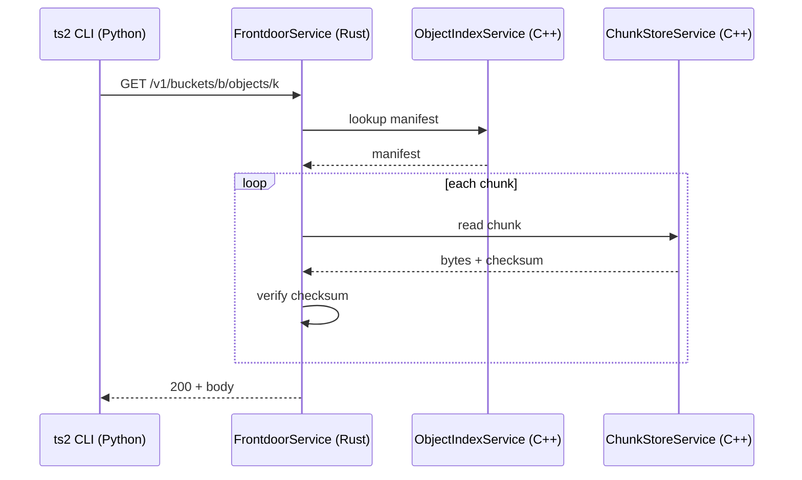
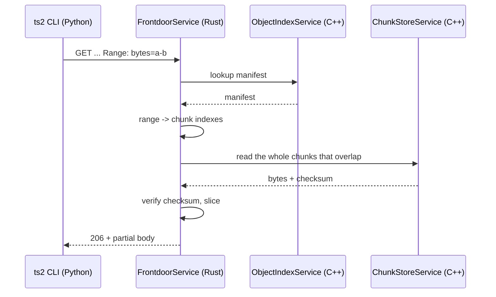
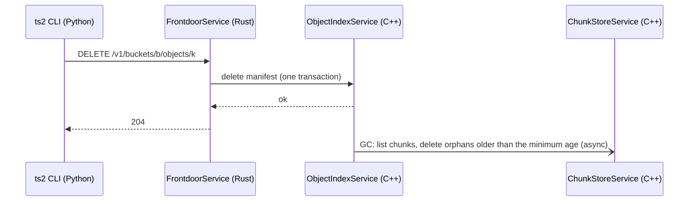
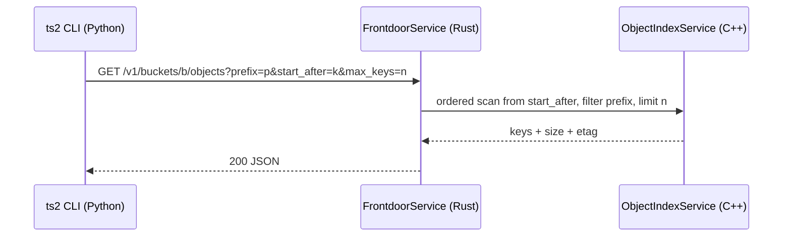

# 000: System overview

Status: draft. Read time: about 15 minutes.

Glossary. The shape is front end, index, storage, like S3. **FrontdoorService** is the front end. **ObjectIndexService** is the index. **ChunkStoreService** is storage. **BucketRegistryService** holds buckets, tenants and quotas. A **cell** is a self-contained copy of one ObjectIndexService plus its ChunkStoreService nodes. Service names are multi-word on purpose, see [ADR 0007](../adr/0007-multi-word-service-names.md). Every diagram labels the language of each service.

## 1. Context

TS2 (Toy Storage Service) is an S3-like object store built to learn storage internals. Clients talk JSON REST to FrontdoorService. Objects are split into chunks and stored on ChunkStoreService nodes. ObjectIndexService maps each key to a manifest that lists its chunks. Requirements are in the [PRD](../prd.md).

Reference systems, for orientation only:

- MinIO stores each object as an `xl.meta` file plus part files on a regular filesystem (XFS is the usual choice).
- Ceph BlueStore writes to raw block devices, keeps metadata in RocksDB, and places data with CRUSH, a deterministic function from object to devices.
- S3 runs its own HDD fleet. Its storage node software (written in Rust, SOSP 2021 paper) writes shards into log-structured extents with an LSM-tree index. S3's architecture as presented at re:Invent 2023 is front end, then index, then storage.

TS2 borrows the shape (front end, index, storage), the deterministic placement idea, and the extent design for v0.6.

## 2. Layers

Three layers, from the client inward:

1. **FrontdoorService** (Rust, `frontdoor/`, binary `ts2-frontdoor`). The web service in front, and the only thing clients reach. It does admission: validates the request, checks size and key limits, later checks auth and quota, and sheds load with 429 or 503 plus `Retry-After`. It never queues requests. It does not write to a database per request; it emits an access log line and metrics instead. After admission it sends bucket and tenant operations to BucketRegistry and object bytes down the data path. It also chunks, hashes and places chunks, through the `ts2-core` library. Object bytes flow through FrontdoorService, see [ADR 0006](../adr/0006-object-bytes-through-frontdoor.md).
2. **BucketRegistryService** (Go from v0.4, `bucket-registry/`). Tenants, buckets, quotas, the bucket-to-cell map and cell health. Until v0.4 it is an in-process Rust module of FrontdoorService called **BucketRegistry**, behind a `BucketRegistry` trait. In v0.1 bucket CRUD lives in the `ObjectIndex` trait because there is one cell and no tenants.
3. **Data plane.** Deployed as cells. Each cell has one ObjectIndexService (C++, `object-index/`, key to manifest) and several ChunkStoreService nodes (C++, `chunk-store/`, chunks).

**What a ChunkStoreService node is.** One process that owns one data directory, which in production means one disk. A production host would have many HDD or NVMe drives and run one process per drive, so the failure domain is the rack. In the compose demo it is one container per node with a named volume. On AWS it is one EC2 instance with EBS or instance-store NVMe.



### BucketRegistryService propagation after the v0.4 extraction

- FrontdoorService calls BucketRegistryService synchronously over gRPC (tonic client, Go gRPC server).
- Registry reads are cached in FrontdoorService. Changes reach it by polling every few seconds. Push may come later.
- Admin writes (create bucket, set quota) are proxied synchronously and are idempotent. FrontdoorService never acknowledges a write the registry has not committed.
- `request_id` and the W3C `traceparent` header travel as gRPC metadata, so one request is traceable across services.
- If BucketRegistryService is down, FrontdoorService keeps serving object traffic from its cache. With a cold cache it returns 503 plus `Retry-After`.

## 3. Cells

A cell is a self-sufficient copy of the data plane: one ObjectIndexService plus N ChunkStoreService nodes, serving a fixed subset of buckets. Cells never talk to each other.

The thin global layer above the cells is FrontdoorService's router plus BucketRegistry's bucket-to-cell map. It is kept small because its blast radius is everyone. Per-cell control functions (node membership, the node list used for placement, health, rebalancing) live inside the cell, so a bug there can hurt only that cell.

Tenant and quota data sits in the thin layer for v0. The alternative is to keep per-cell quota counters inside each cell and sum them, which removes a global dependency from the write path but makes tenant-wide quotas harder. Decision: global for v0, see section 12.

What cells give us:

- **Blast radius.** A bad deploy or a corrupted index affects one cell.
- **Fixed, tested size.** A cell is always the same shape, so we test that shape.
- **Scale by adding cells.** New buckets go to new cells.
- **Cell-by-cell rollout.** Deploy to one cell, watch, continue.
- **Tenant moves.** Copy manifests and chunks to another cell, flip the bucket in BucketRegistry, garbage-collect the source.

## 4. Components and languages

| Component | Directory | Language | Notes |
|---|---|---|---|
| FrontdoorService | `frontdoor/` (binary `ts2-frontdoor`) | Rust | axum, tonic, tower, utoipa 5.x. Admission, routing, object data path. |
| `ts2-core` | `ts2-core/` | Rust (library crate) | Chunking, hashing, placement, and the `ObjectIndex` and `ChunkStore` traits with their in-process SQLite and local-disk implementations. A direct-to-cell client could reuse it later. |
| BucketRegistryService | in `frontdoor/` as `BucketRegistry` until v0.4, then `bucket-registry/` | Rust, then Go | Buckets, tenants, quotas, bucket-to-cell map. gRPC server from v0.4. |
| ObjectIndexService | `object-index/` (not yet created) | C++ | Key to manifest, listing, orphan GC. SQLite first, RocksDB later. |
| ChunkStoreService | `chunk-store/` (not yet created) | C++ | One process, one node, one disk. CMake, vcpkg, Catch2. |
| `ts2` CLI | `cli/` | Python | typer, httpx, client generated from the OpenAPI file; installed with `uv tool install`. |
| Web UI | `ui/` | TypeScript | Later, React possible. |
| End-to-end tests | `tests/e2e/` | Python | uv, pytest, httpx; shares uv tooling with the CLI. |

Contracts: the external API is OpenAPI 3.1. FrontdoorService uses utoipa 5.x (utoipa 4 emits 3.0) to build the spec from annotated axum handlers, serves it at `/openapi.json` and serves a Scalar UI at `/docs`. A test writes the spec to `docs/api/openapi.yaml`, so API changes show up in review diffs and the file imports into Bruno or curl workflows. The Python CLI client is generated from that file. `openapi-python-client` buffers request bodies in memory, so the CLI uses plain `httpx` for object bytes and the generated client for everything else. The internal API is Protobuf over gRPC in `proto/ts2/v1`. Rationale in [ADR 0001](../adr/0001-json-rest-over-s3-wire-compat.md) and [ADR 0002](../adr/0002-rust-frontdoor-go-bucket-registry-cpp-data-plane.md).

The in-process traits are async and chunk-granular from the start, shaped like the gRPC calls that replace them. `ChunkStore::put` takes one chunk (at most `chunk_bytes`, 4 MiB by default) and FrontdoorService streams the object through them, so memory per request stays bounded.

External endpoints (all under `/v1`):

- Buckets: create, list, get, delete. Deleting a non-empty bucket returns 409.
- Objects at `/v1/buckets/{bucket}/objects/{*key}`: PUT, GET (with `Range`), HEAD, DELETE. Keys may contain slashes. They are percent-decoded once, and empty keys and `..` segments are rejected with 400.
- List objects: GET with `prefix`, `start_after`, `max_keys`. The IETF HTTP QUERY method is parked until it is an RFC.
- `GET /healthz`, `GET /v1/quotas` (v0.3).

## 5. Request paths

Terms: a **chunk** is a fixed-size slice of an object. A **manifest** is the record for one key: its metadata plus the list of chunks. A **cell** is defined above.

### Placement

Placement is owned by `ts2-core` inside FrontdoorService. ObjectIndexService does not place chunks. For each chunk FrontdoorService generates a random `chunk_id`, then picks the node with a pure function: v0.2 `node = hash(chunk_id) mod N` over the cell's node list with replication factor R=1, and from v0.4 R=3 across failure domains. The node list comes from FrontdoorService's config in v0.2 and from BucketRegistry once it holds the cell map. Like Ceph's CRUSH the rule is deterministic, but the manifest records the `node_id` of every chunk, so changing the rule later does not strand old objects.

### PUT

Invariant: chunks are durable before the manifest is committed. A crash in between leaves orphan chunks for garbage collection (GC). It never leaves a manifest that points at missing chunks.



The body limit of axum (2 MiB by default) is disabled on PUT. FrontdoorService enforces `max_object_bytes` while streaming, and returns 413 as soon as the declared `Content-Length` or the bytes read exceed it. Chunked uploads without `Content-Length` are accepted.

Overwrite is last writer wins: the second PUT replaces the manifest and increments `version`. `If-None-Match: *` makes a PUT create-only and returns 412 if the key exists. `If-Match` is planned with versioning (not v0).

### GET



Responses to GET and HEAD carry `ETag`, `Content-Length`, `Content-Type` and `Accept-Ranges: bytes`. A checksum failure on the first chunk returns 500 before any body bytes are sent. After the response has started a failure can only abort the connection, so the client sees a truncated body.

### Range GET

The chunk checksum covers the whole chunk, so a partial read could not be verified. FrontdoorService therefore maps the byte range to chunk indexes using `chunk_bytes` from the manifest, reads whole chunks, verifies each checksum, and then slices the first and last chunk to the requested bytes. Every chunk except the last is exactly `chunk_bytes`, which keeps the mapping a division. Inline objects are served from the manifest.

Supported: `bytes=a-b`, `bytes=a-` and `bytes=-n`, answered with 206. An unsatisfiable range, or several ranges in one header, returns 416. Sub-chunk checksums would allow partial reads and are a later option.



### DELETE

Delete removes the manifest in one transaction and returns 204. The chunks become orphans. In v0.1 FrontdoorService also deletes them best effort right after the manifest, and a failure there is ignored. The real cleanup is the diff-based GC in section 12, which finds any orphan regardless of how it came about. Deleting the manifest first keeps the invariant: no manifest ever points at a missing chunk.



### List



List touches only ObjectIndexService. Keys are ordered bytewise. `max_keys` is capped (default 1000). The response has `is_truncated` and a `next` marker to pass as `start_after`.

## 6. Data model

Manifest, one per object key:

| Field | Meaning |
|---|---|
| `bucket`, `key` | identity |
| `version` | manifest version number |
| `size` | object size in bytes |
| `etag` | hex SHA-256 of the whole object, computed by FrontdoorService from the stream |
| `content_type` | as supplied by the client |
| `created_at` | commit time |
| `metadata` | user metadata, string map |
| `inline_data` | object bytes, present only when size is below `inline_threshold_bytes` |
| `chunk_bytes` | chunk size used for this object |
| `chunks` | list of `(chunk_id, node_id, length, checksum)`, present only when not inline |

An object has either `inline_data` or `chunks`, never both.

Chunk ids are random 128-bit values. The content hash is stored beside the id as the checksum. Content-addressed ids (id = hash of bytes) would give deduplication but require reference counting before GC can delete a chunk. That is rejected for v0, see [ADR 0003](../adr/0003-random-chunk-ids-not-content-addressed.md).

## 7. On-disk layout

Both layouts sit behind one ChunkStore interface: `put`, `get(range)`, `delete`, `list` (chunk ids with their creation time, for GC), and `scrub` later. In v0.1 the interface is the Rust `ChunkStore` trait in `ts2-core`. From the ChunkStoreService step it is a gRPC service implemented in C++.

**v0.1: one file per chunk.** MinIO style, easy to debug with `ls`.

```
node-root/
  node.json
  tmp/                 in-flight writes
  data/chunks/ab/cd/<chunk_id>
```

A write goes to `tmp/`, is written, fsynced, renamed into place, and then the parent directory is fsynced. Without the last step a crash can lose the directory entry while the manifest survives. The two-level directory fan-out comes from the first bytes of the id. `tmp/` is emptied at startup, since anything left there is a write that never finished.

**v0.6: extents.** Append-only extent files of 1 GiB. An index maps `chunk_id -> (extent, offset, len, crc)` and lives in RocksDB. Compaction reclaims holes left by deletes, and a scrub pass re-reads data and checks crcs. This is the S3 and Haystack style. The v0.6 milestone benchmarks it against the file-per-chunk layout.

**Platform differences** live in a `FileSystem` abstraction: `fsync` on Linux versus `fcntl(F_FULLFSYNC)` on macOS, and an optional Linux-only `O_DIRECT` and io_uring backend. On macOS `fsync` does not flush the drive cache, `F_FULLFSYNC` does, and SQLite only uses it when `PRAGMA fullfsync=ON` (off by default). `O_DIRECT` needs aligned buffers and fails on some filesystems (tmpfs, some overlayfs), so it stays optional. Docker Desktop on a Mac runs Linux in a VM, so containers never exercise `F_FULLFSYNC`. The macOS paths run only when a service is started natively (`make run`).

## 8. Configuration and limits

Each service loads a config file and reloads it on change (SIGHUP or file watch). Limits and feature flags therefore change without a redeploy. A `flags` block in the same file holds feature flags. A config service and OpenFeature with flagd are deferred, see [ADR 0005](../adr/0005-file-reload-config-before-config-service.md).

```yaml
limits:
  max_object_bytes: 268435456      # 256 MiB, 413 when exceeded
  max_key_bytes: 1024
  inline_threshold_bytes: 65536    # 64 KiB
  chunk_bytes: 4194304             # 4 MiB
flags: {}
```

Safe to change later: anything recorded per object in the manifest (`chunk_bytes`, `inline_threshold_bytes`) and `max_object_bytes` upward. Not safe: `max_key_bytes` downward, since existing keys may be longer.

Quotas are per-tenant defaults with overrides (buckets per tenant, bytes per bucket, requests/s). They are stored in BucketRegistry, enforced at admission from a cached snapshot, and exposed at `GET /v1/quotas`. Milestone v0.3.

Errors use RFC 9457 Problem Details with a `request_id` extension. Responses carry `Server: ts2-frontdoor/<version>` and `x-ts2-request-id`.

Other behavior at the edge:

- **Full disk.** A ChunkStoreService node stops accepting writes above a usage threshold (default 95%) and answers with an error that FrontdoorService maps to 507. It chooses another node when placement allows it. The disk-used alarm fires earlier, at 85%.
- **Shutdown.** On SIGTERM a service stops accepting new requests, finishes in-flight ones for up to a drain timeout, then exits.
- **Timeouts.** FrontdoorService sets a header-read timeout, an idle timeout and a minimum upload rate, so slow clients cannot hold connections forever. Exact values are set when admission is built.
- **TLS.** Terminated at the load balancer (section 10). Services speak plain HTTP and gRPC inside the deployment.
- **ChunkStoreService access.** Until the per-request token arrives in v0.2, the compose ports are bound to the compose network only and are never published to the host.

## 9. Observability

OpenTelemetry (OTel) SDK in every service, sending to an OTel Collector. The Collector forwards metrics to VictoriaMetrics and logs to VictoriaLogs. Both accept OTLP over HTTP only, not gRPC, so the Collector uses the `otlphttp` exporter with a per-signal path for each. Grafana reads both, with dashboards provisioned from the repo. This mirrors the public description of Roblox's pipeline (OTel SDK and Collector, a Kafka buffer, Logstash and Elastic for logs, VictoriaMetrics, Grafana), minus Kafka and with VictoriaLogs instead of Elastic to stay light. The OTel metrics and logs SDKs for Rust and C++ are younger than Go's, so expect rough edges there.

Traces come later, with Tempo or VictoriaTraces. Until then every request is still followable across services: `x-ts2-request-id` is logged by every service and passed on as gRPC metadata.

| Scope | Metrics | Alarms |
|---|---|---|
| FrontdoorService | RED (rate, errors, duration) per API, bytes in and out, in-flight requests | 5xx above 0.1% for 5 min; p99 PUT above 500 ms; in-flight near cap |
| ObjectIndexService | op latency, RocksDB stalls, WAL size | stall above 0; p99 lookup above 20 ms |
| ChunkStoreService | disk used %, chunk read and write latency, fsync latency, IO errors, scrub failures, under-replicated chunks, repair backlog | disk above 85%; any IO error; under-replicated above 0 for 10 min; scrub failure above 0 |
| Cell | SLO burn rate, fast (1 h) and slow (6 h) | burn-rate alerts on both windows |

RocksDB metrics apply from v0.3. Under-replicated and repair metrics apply from v0.4.

## 10. Deployment

Local first. `make` is the only entry point: `build`, `test`, `run`, `up`, `down`, `chaos`, each dispatching to the components.

- **Native:** `make run` starts FrontdoorService on macOS or Linux with local data under `./data`.
- **Compose:** FrontdoorService (BucketRegistry in-process until v0.4), later 2 cells each with an ObjectIndexService and 3 ChunkStoreService nodes. Named volume per node. `--profile obs` adds the observability stack. Containers are linux/arm64.
- **Later, k3d and Helm:** ChunkStoreService nodes as a StatefulSet.
- **Later, AWS via CDK on Graviton:** first one EC2 instance running compose, then 3 nodes on k3s, one per AZ.

**Load balancer.** Every real deployment is DNS, then a load balancer, then the FrontdoorService fleet. Compose has none (Traefik is optional for local TLS). k3d uses an Ingress. On AWS start with an ALB (application load balancer): it terminates TLS, runs HTTP health checks and routes by path, for example to the UI. Move to an NLB (network load balancer) when raw throughput matters, since it works at layer 4 and does no HTTP parsing.

Container images are linux/arm64, cross-built with buildx from the Mac. Artifacts come from GitHub Actions and GHCR, or ECR, through a script that switches on `ARTIFACT_SOURCE=local|github|aws`.

Repo layout (monorepo, one component per commit so each is testable alone): `Makefile`, `docs/`, `proto/`, `frontdoor/`, `ts2-core/`, `bucket-registry/` (v0.4), `cli/`, `object-index/`, `chunk-store/`, `ui/`, `deploy/compose/`, `deploy/cdk/`, `tests/e2e/`.

## 11. Per-component design docs

To be written:

- 001, FrontdoorService: admission, load shedding, routing, streaming and chunking.
- 002, BucketRegistryService: tenants, buckets, quotas, bucket-to-cell map, cell health, jobs API.
- 003, ObjectIndexService: manifest schema, transactions, list, orphan GC, SQLite then RocksDB.
- 004, ChunkStoreService: ChunkStore, FileSystem abstraction, extents, scrub.
- 005, Placement and replication: the placement rule, R=3, failure domains, erasure coding, repair.
- 006, Observability: metric names, dashboards, alarms, SLO math.
- 007, Deployment: compose, k3d, CDK, artifact sources.

## 12. Decisions and open questions

### Decisions

- **Orphan chunk GC.** Owned by ObjectIndexService and diff-based. It periodically lists the chunk ids (with creation time) on each ChunkStoreService node and deletes ids that no manifest references. It never deletes a chunk younger than `gc_min_chunk_age` (default 24 h), because a chunk of an in-flight PUT looks like an orphan until its manifest commits. Nothing returns a chunk list on DELETE.
- **Index durability.** ObjectIndexService is a single process with one database per cell and no replica from v0.1 to v0.4. Replication and erasure coding protect chunks, not manifests, so losing the index loses every object in the cell. Mitigation: periodic backups of the database (SQLite online backup, later RocksDB checkpoints) to a separate volume, plus a restore drill.
- **Overwrite.** A second PUT replaces the manifest and increments `version`. The old chunks become orphans for GC. No user-visible object versioning in v0.
- **ETag.** Hex SHA-256 of the whole object, computed by FrontdoorService from the stream. From v0.2 a client may send `x-ts2-checksum-sha256`, and a mismatch returns 400.
- **Quota counters.** Global, in BucketRegistry, for v0.
- **Registry changes reach FrontdoorService** by polling every few seconds. Push may come later.
- **Admin writes** (create bucket, set quota) are synchronous and return 201 or 204. Each is one database row.
- **Long-running workflows** (bulk bucket delete, tenant moves, rebalance, repair, tiering, key and cert rotation) use a jobs API: the request returns 202 with `Location: /v1/jobs/{id}`. A job row in the registry database is the queue, and each step is idempotent and resumable. This first appears in v0.4. Temporal is a possible later engine for these jobs and is explicitly deferred.
- **Idempotency.** Every API is idempotent or carries an idempotency key. FrontdoorService never acknowledges a write it has not seen committed downstream.
- **Chunk token.** From v0.2 ChunkStoreService requires a per-request token minted by FrontdoorService. See [ADR 0006](../adr/0006-object-bytes-through-frontdoor.md).
- **Two index implementations.** The SQLite `ObjectIndex` in `ts2-core` and the C++ ObjectIndexService have separate schemas. The rewrite is accepted: the Rust one is the v0.1 stand-in and is kept for tests and single-binary runs.

### Open questions

- How FrontdoorService learns about a bucket move between cells before its next poll (stale routing window, and what ObjectIndexService or ChunkStoreService does with a misrouted request).
- Whether the Python e2e suite runs against compose only or also against k3d.
