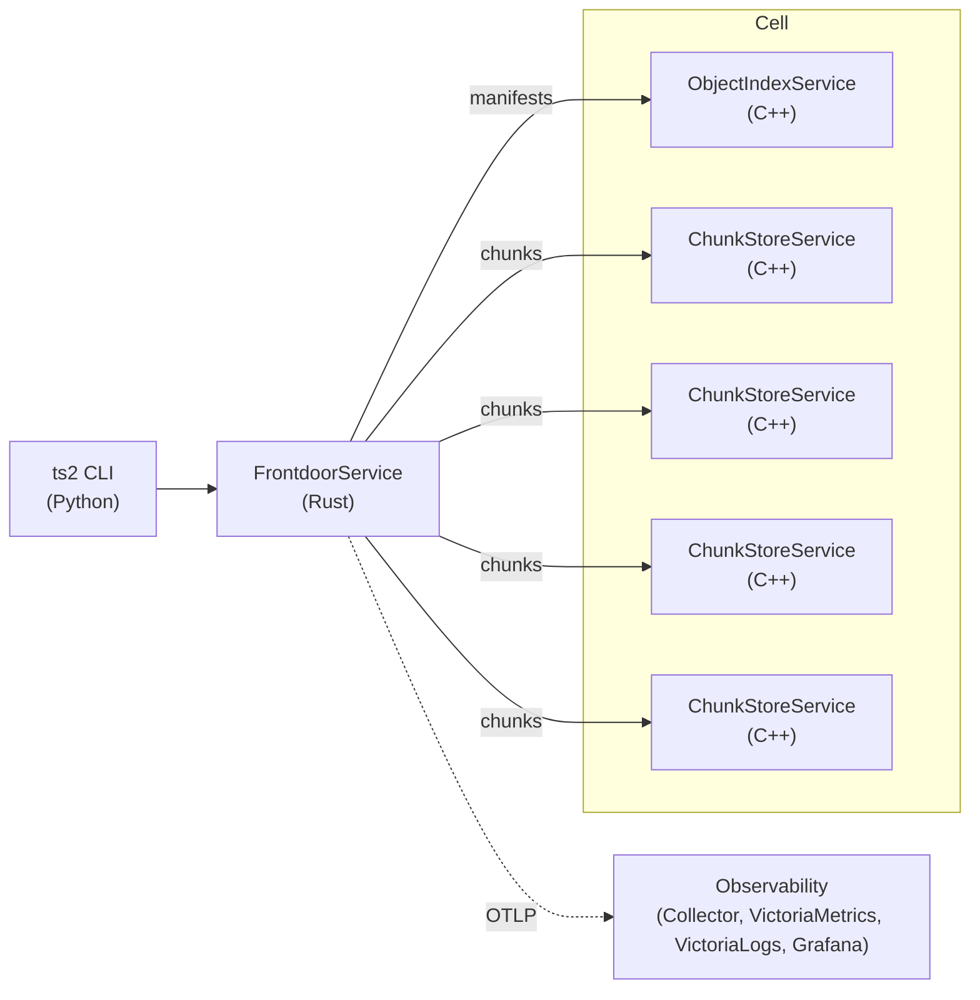

# Engineering

How TS2 works inside. This section is for engineers, PMs and anyone learning how an object store is built. If you only want to use TS2, start with the [customer guide](../guide/overview.md).

Pages: [components](components.md), [operations](operations.md), [system overview](../design/000-system-overview.md), [PRD](../prd.md), [ADRs](../adr/0001-json-rest-over-s3-wire-compat.md), [plan](../plan.md), [backlog](../backlog.md), [setup](../setup.md), [demo](../demo.md) and the [port registry](../ports.md).

## Three words you need

**Bucket and key.** A bucket is a named container, like `photos`. A key is an object's name inside a bucket, like `cats/cat.jpg`. A key looks like a path, but there are no directories. The slash is just a character, and listing "everything under `cats/`" is a string prefix scan over the keys.

**Chunk.** Objects bigger than 64 KiB are cut into pieces of 4 MiB, called chunks. Each chunk gets a random id and is stored on one ChunkStoreService node. A 9 MiB photo becomes three chunks: 4 MiB, 4 MiB and 1 MiB.

**Manifest.** The manifest is the small record kept for each object. It holds the size, ETag, content type, version, and the ordered list of chunk ids with the node that holds each one. Objects under 64 KiB skip chunking and sit inside the manifest itself (`inline_data`). To read an object, you look up its manifest, then fetch its chunks in order.

??? example "The manifest for `photos/cats/cat.jpg`, a 9 MiB file (hashes shortened)"

    ```json
    {
      "bucket": "photos",
      "key": "cats/cat.jpg",
      "version": 1,
      "size": 9437184,
      "etag": "9f2c…e1",
      "content_type": "image/jpeg",
      "created_at": "2026-11-22T09:30:00Z",
      "metadata": {},
      "chunk_bytes": 4194304,
      "chunks": [
        { "chunk_id": "a1b2…01", "node_id": "node-1", "length": 4194304, "checksum": "77d0…3a" },
        { "chunk_id": "c3d4…02", "node_id": "node-3", "length": 4194304, "checksum": "0be5…c9" },
        { "chunk_id": "e5f6…03", "node_id": "node-2", "length": 1048576, "checksum": "d41f…58" }
      ]
    }
    ```

## Architecture

Clients talk only to FrontdoorService. It cuts uploads into chunks, writes them to ChunkStoreService nodes, then writes the manifest to ObjectIndexService. Reads go the other way. Each box names its language. The diagram shows what is built: one cell, no separate bucket service.



`make run` starts FrontdoorService alone, and then `ts2-core` runs a SQLite file as the index and a local directory as the chunk store inside the FrontdoorService process. `make up` uses the C++ services instead. Both modes implement the same traits.

## Try it

Start the service with `make run`. It listens on `127.0.0.1:9000` and keeps data in `./data`. Then, in another terminal:

=== "ts2 CLI"

    ```sh
    uv tool install --editable ./cli
    head -c 10485760 /dev/urandom > big.bin
    ts2 mb demo
    ts2 cp big.bin ts2://demo/big.bin
    ts2 ls demo
    ts2 cp ts2://demo/big.bin copy.bin
    ```

    All commands and options are in the [CLI reference](../cli/index.md).

=== "curl"

    ```sh
    B=http://127.0.0.1:9000/v1/buckets
    curl -X POST $B -H 'content-type: application/json' -d '{"name":"demo"}'
    echo 'hello ts2' > hello.txt
    curl -X PUT $B/demo/objects/docs/hello.txt -H 'content-type: text/plain' --data-binary @hello.txt
    curl -s $B/demo/objects/docs/hello.txt
    curl -s "$B/demo/objects?prefix=docs/"
    ```

=== "Grafana"

    ```sh
    make up-obs
    # FrontdoorService: http://127.0.0.1:9001
    # Grafana: http://localhost:3000, dashboard "frontdoor"
    ```

    Send some requests with curl or the CLI and watch the dashboard fill in.

The [demo](../demo.md) covers range reads, paging, errors and the 413 limit. A running service also serves interactive API docs at <http://127.0.0.1:9000/docs>.

## Where it is today

| Milestone | Scope | Status |
|-----------|-------|--------|
| v0.1 | Single node: FrontdoorService, SQLite index, local-disk chunks, CLI, compose, observability | Done: `57cc01a`, `5a08d40`, `3f0efb0`, `14b88b9`, `0f8703f` |
| v0.2 | C++ ChunkStoreService and ObjectIndexService, 4 nodes, API key auth | Partly done: both C++ services, four nodes, rendezvous placement and orphan chunk cleanup are built. API key auth, the chunk token, config reload and C++ service metrics are not built. |
| v0.3 | Multipart upload, presigned URLs, quotas, RocksDB index | Planned |
| v0.4 | Two cells, R=3 replication, failure drills, Go BucketRegistryService | Planned |
| v0.5 | Erasure coding k=4 m=2, scrub and repair | Planned |
| v0.6 | Extent-based ChunkStoreService, benchmark | Planned |
| v0.7 | Node join and leave, rebalance, rolling upgrade, S3 cold tier | Planned |

The commit-by-commit detail is in the [plan](../plan.md).

## Read next

[PRD](../prd.md), [system overview](../design/000-system-overview.md) (components and languages, request paths, data model), [ADRs](../adr/0001-json-rest-over-s3-wire-compat.md) and the [plan](../plan.md).
