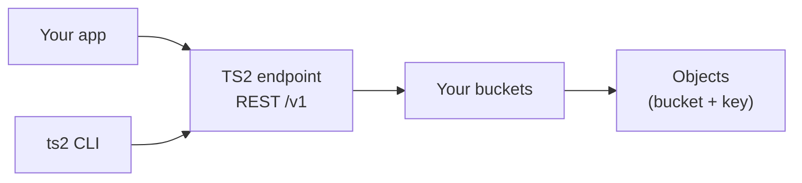

# What TS2 is

TS2 is an internal object storage service. It gives your team storage for files of any type: images, video, datasets, backups, logs. It is not durable yet: each object has one copy. You store a file under a name and read the same bytes back later, from anywhere that can reach the endpoint.

Everything is addressed by two names: a **bucket** (a named container) and a **key** (the object's name inside it). `photos` and `cats/cat.jpg` together identify one file.

You only deal with the endpoint. How the bytes are stored is our job.

## Who it is for

Teams that need to keep blobs and do not want to build size limits, error handling, cleanup and dashboards themselves. If your data is files (not rows you query), TS2 is a fit.

## Typical uses

| Use | Example |
|---|---|
| Assets | Images, renders, video files served to your own tools |
| Backups | Nightly exports and database dumps |
| ML datasets | Training data read in whole or by byte range |
| Logs and extracts | Batch output you keep for a while |

## What it is not

- Not a file system. Keys look like paths, but there are no folders to create or rename.
- Not a database. You cannot query inside an object.
- Not S3 wire compatible. The API is plain JSON over REST, see the [API reference](../api/index.md).
- Not a production service. TS2 is a learning project, so read [service levels](service-levels.md) before you depend on it.

Next: [concepts](concepts.md), then [getting started](getting-started.md).
