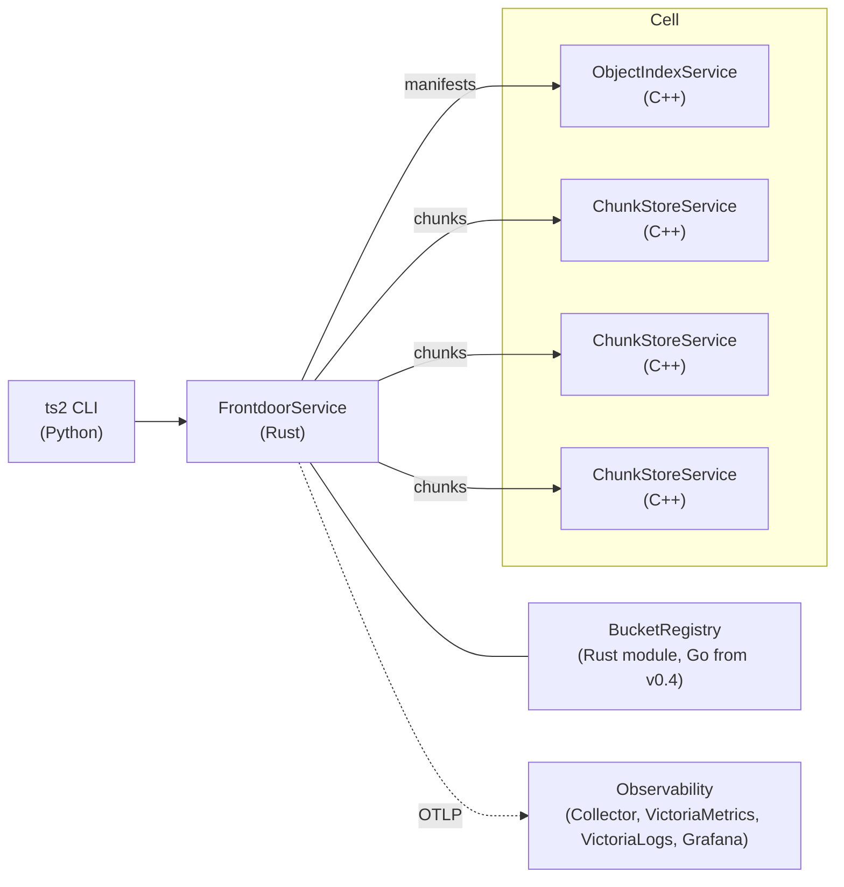

# TS2, the Toy Storage Service

**Store a file under a name, get the same bytes back later.**

TS2 is an S3-like object store that runs on a laptop, with a plain JSON REST API. It is built one component per commit, to learn how object storage works on the inside.

[Try it](demo.md){ .md-button .md-button--primary }
[System overview](design/000-system-overview.md){ .md-button }

---

## Three words you need

**Bucket and key.** A bucket is a named container, like `photos`. A key is an object's name inside a bucket, like `cats/cat.jpg`. A key looks like a path, but there are no directories. The slash is just a character, and listing "everything under `cats/`" is a string prefix scan over the keys.

**Chunk.** Objects bigger than 64 KiB are cut into pieces of 4 MiB, called chunks. Each chunk gets a random id and is stored on one ChunkStoreService node. A 9 MiB photo becomes three chunks: 4 MiB, 4 MiB and 1 MiB.

**Manifest.** The manifest is the small record kept for each object. It holds the size, ETag, content type, version, and the ordered list of chunk ids with the node that holds each one. Objects under 64 KiB skip chunking and sit inside the manifest itself (`inline_data`). To read an object, you look up its manifest, then fetch its chunks in order.

??? example "The manifest for `photos/cats/cat.jpg`, a 9 MiB file (hashes shortened)"

    ```json
    {
      "bucket": "photos",
      "key": "cats/cat.jpg",
      "version": 1,
      "size": 9437184,
      "etag": "9f2c…e1",
      "content_type": "image/jpeg",
      "created_at": "2026-11-22T09:30:00Z",
      "metadata": {},
      "chunk_bytes": 4194304,
      "chunks": [
        { "chunk_id": "a1b2…01", "node_id": "node-1", "length": 4194304, "checksum": "77d0…3a" },
        { "chunk_id": "c3d4…02", "node_id": "node-3", "length": 4194304, "checksum": "0be5…c9" },
        { "chunk_id": "e5f6…03", "node_id": "node-2", "length": 1048576, "checksum": "d41f…58" }
      ]
    }
    ```

## Architecture

Clients talk only to FrontdoorService. It cuts uploads into chunks, writes them to ChunkStoreService nodes, then writes the manifest to ObjectIndexService. Reads go the other way. Each box names its language.



Until the C++ services exist, `ts2-core` runs a SQLite file as the index and a local directory as the chunk store, inside the FrontdoorService process. They implement the same traits the real services will.

## Components

<div class="grid cards" markdown>

-   :material-door-open: **FrontdoorService**

    ---

    Rust. The only thing clients talk to. Checks limits, chunks uploads, serves the REST API and OpenAPI docs.

    **Status:** built (v0.1). [Design](design/000-system-overview.md#4-components-and-languages)

-   :material-cube-outline: **ts2-core**

    ---

    Rust library. Manifest model, chunking, hashing, placement, and the ObjectIndex and ChunkStore traits with SQLite and local-disk implementations.

    **Status:** built (v0.1). [Design](design/000-system-overview.md#4-components-and-languages)

-   :material-format-list-bulleted: **ObjectIndexService**

    ---

    C++. Stores manifests by (bucket, key) and answers listings. It never sees object bytes.

    **Status:** planned, proto scaffold in progress (v0.2). [Design](design/000-system-overview.md#4-components-and-languages)

-   :material-harddisk: **ChunkStoreService**

    ---

    C++. Stores chunks, one process per data directory. `put`, `get(range)`, `delete`, `list`.

    **Status:** planned, proto scaffold in progress (v0.2). [Design](design/000-system-overview.md#4-components-and-languages)

-   :material-folder-key-outline: **BucketRegistry**

    ---

    Rust module now, Go service from v0.4. Knows which buckets exist, who owns them, their quotas and which cell holds them.

    **Status:** built as a module (v0.1), Go service planned (v0.4). [Design](design/000-system-overview.md#4-components-and-languages)

-   :material-console: **ts2 CLI**

    ---

    Python. `mb`, `cp`, `ls`, `head`, `rm` and `rb` against the REST API, plus the end-to-end smoke test.

    **Status:** built. [Demo](demo.md#with-the-cli)

-   :material-chart-line: **Observability**

    ---

    OpenTelemetry Collector, VictoriaMetrics, VictoriaLogs and a Grafana dashboard, behind the compose `obs` profile.

    **Status:** built for FrontdoorService. [Design](design/000-system-overview.md#9-observability)

</div>

## Quickstart

Start the service with `make run`. It listens on `127.0.0.1:9000` and keeps data in `./data`.

=== "curl"

    ```sh
    B=http://127.0.0.1:9000/v1/buckets
    curl -X POST $B -H 'content-type: application/json' -d '{"name":"demo"}'
    echo 'hello ts2' > hello.txt
    curl -X PUT $B/demo/objects/docs/hello.txt -H 'content-type: text/plain' --data-binary @hello.txt
    curl -s $B/demo/objects/docs/hello.txt
    curl -s "$B/demo/objects?prefix=docs/"
    ```

=== "ts2 CLI"

    ```sh
    uv tool install --editable ./cli
    ts2 mb demo
    ts2 cp ./big.bin ts2://demo/big.bin
    ts2 ls demo
    ts2 cp ts2://demo/big.bin ./copy.bin
    ```

=== "Grafana"

    ```sh
    make up-obs
    # Grafana: http://localhost:3000, dashboard "frontdoor"
    ```

    Send some requests with curl or the CLI and watch the dashboard fill in.

The [demo](demo.md) covers range reads, paging, errors and the 413 limit. Interactive API docs live at <http://127.0.0.1:9000/docs> while the service runs.

## Where it is today

| Milestone | Scope | Status |
|-----------|-------|--------|
| v0.1 | Single node: FrontdoorService, SQLite index, local-disk chunks, CLI, compose, observability | Done: `57cc01a`, `5a08d40`, `3f0efb0`, `14b88b9`, `0f8703f` |
| v0.2 | C++ ChunkStoreService and ObjectIndexService, 3 nodes, API key auth | In progress: proto and C++ scaffold |
| v0.3 | Multipart upload, presigned URLs, quotas, RocksDB index | Planned |
| v0.4 | Two cells, R=3 replication, failure drills, Go BucketRegistryService | Planned |
| v0.5 | Erasure coding k=4 m=2, scrub and repair | Planned |
| v0.6 | Extent-based ChunkStoreService, benchmark | Planned |
| v0.7 | Node join and leave, rebalance, rolling upgrade, S3 cold tier | Planned |

The commit-by-commit detail is in the [plan](plan.md).

## Read next

<div class="grid cards" markdown>

-   :material-file-document-outline: **[PRD](prd.md)**

    Requirements, limits and milestones.

-   :material-sitemap-outline: **[System overview](design/000-system-overview.md)**

    Layers, cells, request paths and the data model.

-   :material-scale-balance: **[ADRs](adr/0001-json-rest-over-s3-wire-compat.md)**

    Why things are the way they are.

-   :material-timeline-check-outline: **[Plan](plan.md)**

    What is built and what comes next.

-   :material-playlist-check: **[Backlog](backlog.md)**

    Features by milestone, plus unscheduled.

</div>
